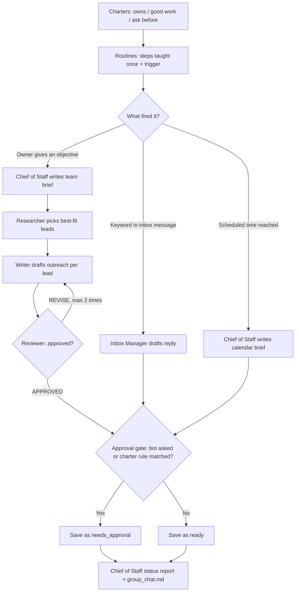

# onebot-company

Runs a one-person company with role-based Grok bots. Each bot has a charter and an approval gate. You teach a task once and it becomes a routine that runs on a schedule or on a trigger. A chief of staff coordinates the researcher → writer → reviewer handoffs.
Inspired by https://www.instagram.com/reel/DfdYoFTva3u/

## Quick start

```bash
python3 -m venv .venv && source .venv/bin/activate && pip install -r requirements.txt
cp .env.example .env                      # add XAI_API_KEY to use the real Grok API
python -m onebot --demo objective "Book 5 intro calls with Texas clinics"   # offline demo, no key needed
python -m onebot --demo inbox && python -m onebot --demo brief
python -m onebot inbox                    # for real: replies to pricing questions in INBOX_FILE
python -m onebot scheduler                # for real: runs scheduled routines (e.g. 08:00 brief) all day
```

Teach a new routine: `python -m onebot teach --name refund_reply --bot inbox_manager --trigger "keywords:refund,cancel" --steps "1. Apologise 2. Say the owner will confirm"`.
Triggers can be `keywords:a,b`, `daily:HH:MM` or `weekdays:HH:MM`. Pass `--steps @example.txt` to use a worked example you wrote down.
Run tests: `pytest -q`.

## How it works

1. **Hire roles, not prompts.** Each bot is a YAML file in `company/charters/` that works like a job brief. It lists what the bot owns, what good work looks like, what it must ask you about first (`ask_before`), and hard rules (`approval_triggers`, which are regexes such as prices or the word "refund").
2. **Teach a task once.** A routine in `company/routines.yaml` stores the steps you showed the bot, which bot runs it, and what fires it. It fires either on a keyword in an incoming message (e.g. "pricing") or at a set time (e.g. weekdays 08:00).
3. **Trigger routines.** `inbox` checks each message against the keyword routines and hands every match to its bot. Messages with no match are skipped. `scheduler` checks every minute and runs each scheduled routine once per day, after its time, on its allowed days (e.g. the morning calendar brief).
4. **Approval gate.** Every draft is checked before it is saved. If the bot wrote `NEEDS APPROVAL`, or the text matches one of its charter's `approval_triggers`, the draft is saved as `needs_approval__*.md`. Otherwise it is saved as `ready__*.md`. Nothing is sent automatically.
5. **Group chat for an objective.** `objective "<goal>"` gives the team a goal instead of a task list:
   1. The chief of staff writes a short team brief.
   2. The researcher picks the best-fit leads from `LEADS_FILE`.
   3. The writer drafts one email per lead.
   4. The reviewer replies `APPROVED` or `REVISE: ...`. The writer rewrites, up to 2 times.
   5. Each final draft goes through the approval gate.
   6. The chief of staff writes a status report.
6. **Output.** Each run writes a folder in `out/` with the drafts and a `group_chat.md` transcript of everything the bots said.



## Configuration

| Env var | What it is | Where to get it |
|---|---|---|
| `XAI_API_KEY` | xAI API key for Grok (not needed with `--demo`) | https://console.x.ai |
| `GROK_MODEL` | Grok model name (default `grok-4`) | https://docs.x.ai/docs/models |
| `XAI_BASE_URL` | API base URL (OpenAI-compatible, so another compatible endpoint also works) | Default `https://api.x.ai/v1` |
| `INBOX_FILE` | JSON list of `{id, from, subject, body}` messages | Export from your mail tool; sample in `samples/inbox.json` |
| `CALENDAR_FILE` | JSON list of today's `{start, end, title, attendees}` | Export from your calendar; sample in `samples/calendar.json` |
| `LEADS_FILE` | CSV of leads with at least `id,name` columns | Your CRM export; sample in `samples/leads.csv` |
| `COMPANY_DIR` | Folder containing `charters/` and `routines.yaml` | Default `company` |
| `OUTPUT_DIR` | Where drafts, transcripts and scheduler state go | Default `out` |
